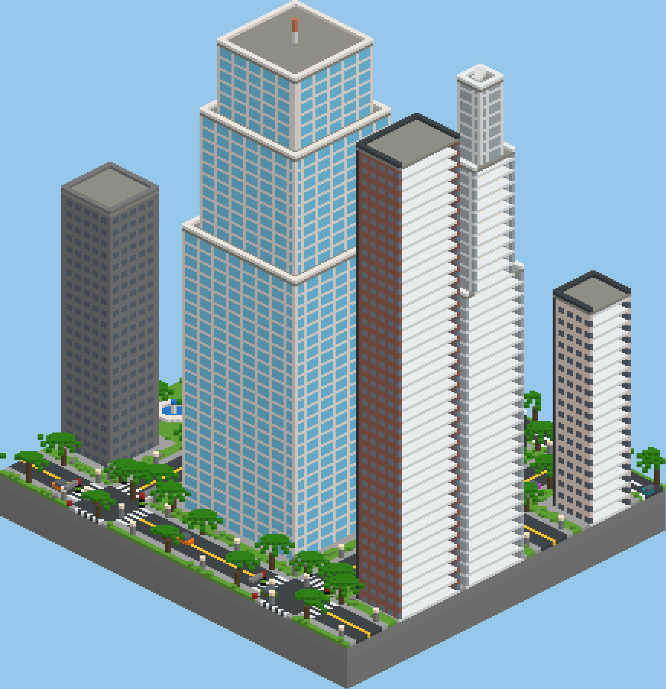
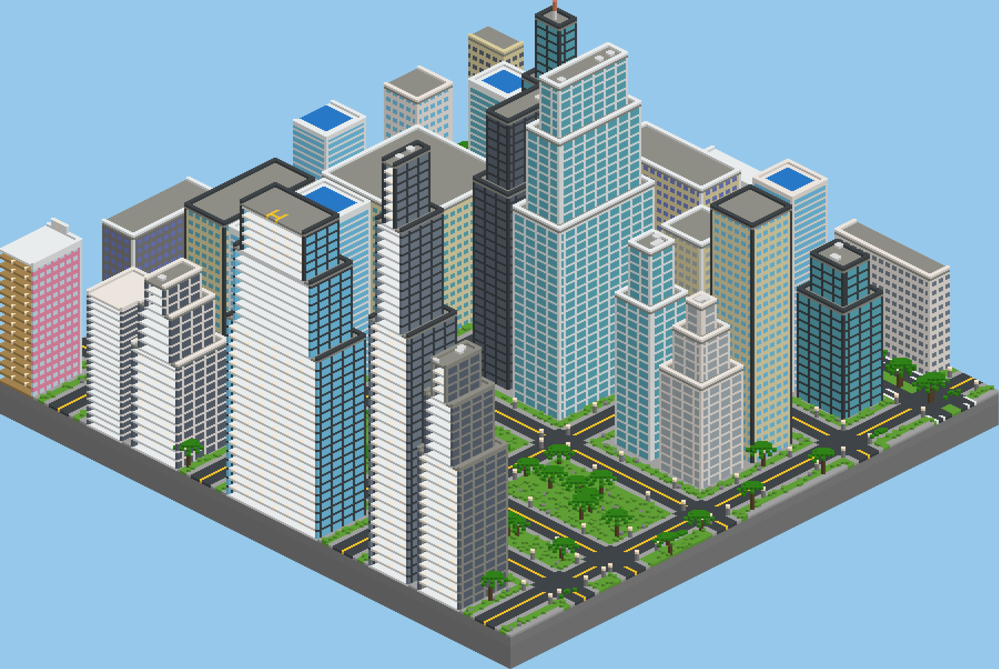

# Palmera: an open-world crime sandbox for Minecraft Bedrock

Palmera is an original tropical state inspired by South Florida's geography. Its gameplay borrows the big-city crime-sandbox genre, but every name, character, story and asset in it is original.


## Play it on Bedrock (phone, Windows, Xbox, PlayStation, Switch)
**One file: `Palmera.mcworld`.** The map and the Palmera Life add-on are built into it.

- **Phone or Windows:** open `Palmera.mcworld` and Minecraft imports it with everything included. Then play it from your Worlds list. You don't need any experimental toggles.
- **Xbox / PlayStation / Switch:** consoles can't import files. Import it on a phone or PC first, then upload it to a **Realm** (Edit World → Replace World) and join the Realm from your console. You can also host it on a **Bedrock Dedicated Server** and connect through Ghost Bridge.
- The full world (12288 × 12288 blocks, ~150 km²) is sent separately because it's too large for GitHub. **`dist/Palmera-2048.mcworld`** is a small 2048 × 2048 version for a quick try.

## What you can do
| | |
|---|---|
| **Story** | 10 original missions with Sol (your partner), Benny (the mechanic who asks no questions), Detective Hale and the kingpin Victor Lazaro. Start it from the Phone. |
| **Phone** | Story, Jobs & Races, Sunshine Arms (guns), Coastline Motors (cars), Real Estate, Palm Bank, GPS, Lawyer, Feed, Stats. |
| **Robberies** | Crouch at a shop counter with a gun out. Corner stores, pawn shops, diners, pharmacies and gas stations all pay out. Each store has a cooldown. |
| **Heists** | Get into a Palm Bank vault and keep drilling for 30 seconds while SWAT waves arrive, for $25k–$45k. |
| **Wanted ★–★★★★★** | Crimes bring police on foot, then police cars with flashing light bars and sirens, then SWAT and a helicopter. Get out of sight to lose them, or pay a lawyer. |
| **Traffic** | AI cars drive the roads. Crouch next to one to steal it. Sedans and sports cars are for sale too. |
| **People** | Human pedestrians with 16 looks walk the sidewalks and scatter when you shoot. The Swamp Kings and Neon Saints gangs hold their own turf. |
| **Wildlife** | Alligators in the swamp, flamingos on the beaches. |
| **Weapons** | Pistol, SMG, Pump Shotgun, Assault Rifle, Sniper, Minigun, Rocket Launcher, Grenades, Baseball Bat, Body Armor, Medkits. |
| **Life** | Bank account (safe when you die), safehouses that become your respawn point and pay daily income, hospitals, six side jobs, three street races. |

## The map
- **Vista Marina:** a huge downtown with glass, round and art-deco skyscrapers, the Marina River and its bridges, a stadium, and street-level shops with interiors and signs (Sunny Mart, Coral Diner, Palm Bank, Police, Hospital, Tiki Bar, Neon Nights and more). Crosswalks, traffic lights, bus stops, hydrants, palms and lamps line the streets.
- **Coral Strand:** a hotel strip on a barrier island, with a beach, a Ferris wheel pier and lifeguard towers.
- **Port Isla and Lakeview:** two more cities. Towns: Citrus Grove, Palmetto, Okee Junction, Cypress Bend, Mangrove Point, Sandpiper.
- **Landmarks:** Port Solano (container port), the international airport (two runways), a spaceport, the Millionaire Isles mansions, a canal district, Funland Palmera theme park, Palmera Speedway, Iron Bay Correctional prison island, the Sawgrass swamp, Lake Solano and its rivers, the Sunset Keys island chain, golf courses, farms, motels, gas stations and strip malls.




## Build it yourself
```
pip install numpy scipy pillow crc32c
python3 generate.py --size 12288 --format bedrock --out out   # -> out/Palmera.mcworld (~20 min, 4 cores)
python3 generate.py --size 2048 --format both --out out       # also writes a Java world + datapack
```
- `bedrock.py` writes Bedrock LevelDB directly. `bedrock_blocks.json` holds the exact Bedrock block states. Regenerate it with `bedrock_map.py` (needs amulet-core) if you add blocks.
- `packs_bedrock.py` and `palmera_main.js` hold the Bedrock add-on. `packs.py` holds the Java datapack.
