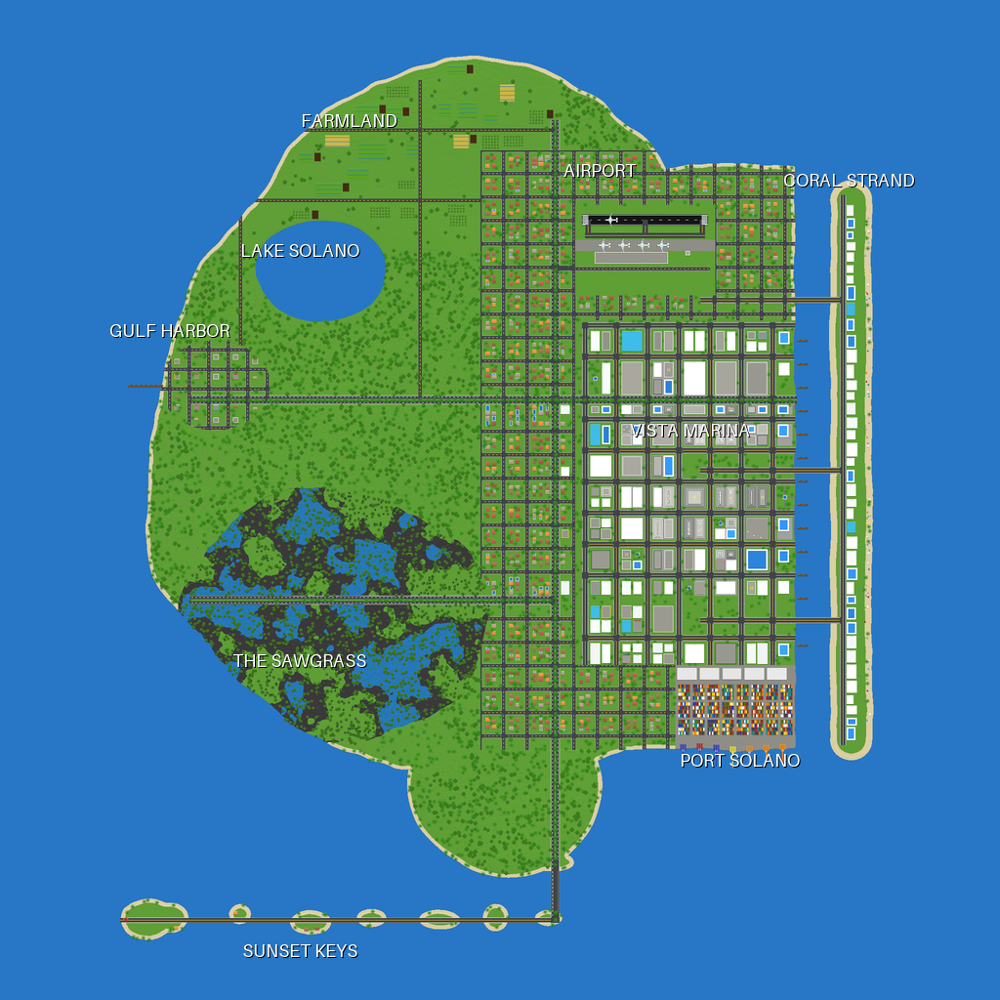

# Palmera: a tropical-state Minecraft world

An original open-world map inspired by South Florida's geography (a coastal metro, a barrier-island beach, the Everglades-style swamp, the Keys). It is not a copy of any game's map. The playable area is 2048 × 2048 blocks and open ocean continues past the edges.



## Download and play
**`dist/Palmera.zip`** is a Java Edition world saved in 1.21.1 format. Newer versions upgrade it automatically when it loads.

- **Java:** unzip the file into `.minecraft/saves/`, then choose **Palmera** in Singleplayer. You start in Creative, cheats are on, and you spawn on the Coral Strand beach.
- **Bedrock (PC, mobile, or console via a server/Realm):** convert the zip with [Chunker](https://chunker.app) (Java → Bedrock) to get a `.mcworld` file. Consoles can't import worlds directly, so upload it to a Realm, or run it on a Bedrock Dedicated Server and join through Ghost Bridge.

## What's in it
| Area | Highlights |
|---|---|
| Vista Marina (east metro) | Glass skyscrapers up to ~185 tall, waterfront condos with rooftop pools, art-deco blocks, a stadium, parks, lane-marked streets with lamps, marina piers |
| Coral Strand (barrier island) | Pastel neon-lit hotels, a beach boulevard, umbrellas, lifeguard towers, three causeways |
| Port Solano | Container stacks, gantry cranes, warehouses |
| Airport | Runway with markings, taxiways, terminal, control tower, parked jets |
| The Sawgrass | Mangrove swamp with lily pads and cypress, crossed by an elevated highway |
| Sunset Keys | An island chain on an overseas bridge, stilt houses, a lighthouse, coral reefs |
| Gulf Harbor | A west-coast town with shops and a fishing pier |
| Inland | Lake Solano, farmland with crops, barns and orange groves, suburbs with backyard pools |


## Regenerate / tweak
```
pip install numpy scipy pillow
python3 generate.py --size 2048 --seed 20261121 --out out   # ~15 s on 4 cores
python3 verify.py out/Palmera                                # independent NBT check (needs nbtlib)
python3 render_iso.py shot.png 1300 800 230 220               # isometric close-up
```
`--size` takes a multiple of 512 (minimum 1024). Change `--seed` to get a different coastline and building layout.
